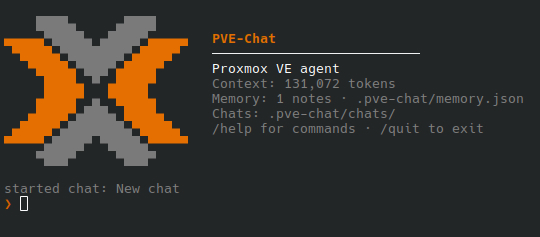
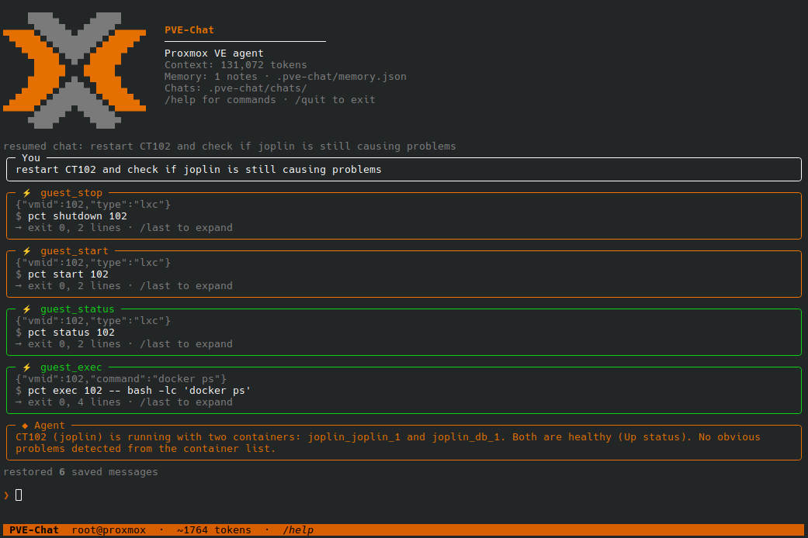

<div align="center">

# PVE-Chat

### Your local AI assistant for Proxmox VE

Run a local GGUF model, chat from your terminal, and manage your Proxmox host
over SSH — with your model and connection settings kept on your machine.

[Get started](#install) · [Run the assistant](#run) · [Safety](#safety-and-privacy)

<p align="center">
  
</p>

</div>

## Requirements

- Linux with Python 3.11 or newer
- SSH access to a Proxmox VE host, preferably using SSH keys
- A GGUF model compatible with `llama.cpp` and its chat template
- Enough system RAM and/or GPU memory for the model and its configured context

The hardware tuner estimates memory fit and can benchmark CPU-only, partial,
and full GPU offload across CPU-thread counts. It compares the median of three
chat decode runs after a warm-up, preserving the configured model, context
length, and KV-cache type. It uses the model's native GGUF chat template when
`server.chat_format = "auto"`, disables thinking where supported, and matches
PVE-Chat's JSON-instruction prompt without enabling slow grammar-constrained
decoding. Batch settings stay fixed, so this tunes generated-token throughput
rather than prompt-processing speed. Estimates are not guarantees, and large
contexts can still exceed available memory. The
tuner reads NVIDIA GPU memory using `nvidia-smi`, AMD GPU memory from Linux
DRM data or the Windows graphics API, and system RAM. Detecting GPU memory
does not install or verify an accelerated `llama.cpp` backend; GPU offload
requires a build compatible with your GPU and drivers.

## Install

```bash
git clone https://github.com/LucaCardoni/Local-Proxmox-AI-Agent.git
cd Local-Proxmox-AI-Agent
python3 -m venv .venv
source .venv/bin/activate
python -m pip install --upgrade pip
python -m pip install -r requirements.txt
python3 setup_config.py
```

`llama-cpp-python` may need to compile locally. For NVIDIA CUDA or other
accelerated backends, follow the installation instructions for
[llama-cpp-python](https://github.com/abetlen/llama-cpp-python) and select a
wheel/build matching your hardware before installing the remaining
requirements. The default pip installation does not guarantee GPU acceleration.

For an AMD GPU on Windows, install the Vulkan-enabled wheel after the regular
requirements. Use the same Python interpreter that runs PVE-Chat:

```powershell
python -m pip install --force-reinstall --only-binary=:all: --no-deps `
  --index-url https://abetlen.github.io/llama-cpp-python/whl/vulkan `
  llama-cpp-python==0.3.36
```

Set `server.n_gpu_layers = -1` in `config.toml` to offload all model layers.
Verify the selected Python environment reports GPU offload support:

```powershell
python -c "from llama_cpp import llama_cpp; print(llama_cpp.llama_supports_gpu_offload())"
```

The command should print `True`. Restart PVE-Chat after changing the package
or configuration; a running process keeps the backend it loaded at startup.

The setup wizard asks for a model path and connection settings, detects
available hardware, and can recommend server settings. It does not connect to
Proxmox or start the model server. The checked-in [`config.example.toml`](./config.example.toml)
is a template only; the wizard creates your ignored local `config.toml`.

Put the GGUF file at the configured model path (by default,
`models/model.gguf`) or change that path in the wizard. Model files are not
included in this repository.

## Run

```bash
python3 main.py
```

Choose one of the menu options:

1. **API server only** — serve the model for another OpenAI-compatible client.
2. **API server + chat** — start the server and open the terminal chat.
3. **Command-line agent** — start the server and use the agent without the chat UI.

You can also choose a mode directly:

```bash
python3 main.py --server-only
python3 main.py --with-chat
python3 main.py --agent
```

During a conversation, tool calls and their concise results appear together,
so you can see what the assistant asked Proxmox to do:

<p align="center">
  
</p>

The server's default endpoint is `http://127.0.0.1:8080/v1`; chat completions
use `/chat/completions`. For example, while the API server is running:

```bash
curl http://127.0.0.1:8080/v1/models
```

The server binds to loopback by default and does not provide API
authentication. Do not expose it to an untrusted network. If you change the
bind address, restrict network access with your firewall and only use a trusted
network.

## Safety and privacy

- Proxmox access uses the configured SSH host and user. Configure SSH keys and
  verify the host key before use; `StrictHostKeyChecking = "yes"` is the sample
  default.
- With the sample config, the agent displays ordinary proposed commands and
  asks before running them. Commands classified as dangerous require you to
  type `yes`; `--yes` only skips approval for safe commands.
- The command classifier is a safeguard, not a security boundary. Review
  commands before approving them, and use SSH permissions appropriate to the
  tasks you intend to perform.
- The API server has no authentication. Keep it on loopback unless you have
  secured access another way.
- Local config, chat history, agent memory, logs, model files, and Python
  environments are excluded from Git. Chat and memory files are stored under
  `.pve-chat/`.

## Configuration

Run `python3 setup_config.py` to review or update `config.toml`. You can edit
that file directly, or use environment overrides such as `PVE_N_CTX` and
`PVE_AGENT_SSH_HOST`. The available overrides are defined in
[`pve_config.py`](./pve_config.py).

## Troubleshooting

- **Missing or unreadable config:** run `python3 setup_config.py`.
- **Model file not found:** check `server.model_path` in `config.toml`.
- **Out of memory / server exits during startup:** use a smaller model, reduce
  `server.n_ctx`, or rerun setup and choose a fitting hardware recommendation.
  Context and memory estimates are approximate.
- **SSH host-key or authentication error:** verify the Proxmox host key and
  confirm that the configured SSH user can connect non-interactively.
- **GPU not detected or used:** check the backend-specific
  `llama-cpp-python` installation and the configured GPU layer count.

## Development

The automated tests are part of the repository and run in GitHub Actions for
Python 3.11–3.13 on pushes and pull requests. To run them locally, create a
virtual environment and install the lightweight test dependencies:

```bash
python3 -m venv .venv
source .venv/bin/activate
python -m pip install pytest rich prompt-toolkit
python -m pytest -q
```

No model download, GPU, Proxmox host, or full `llama-cpp-python` installation
is needed for the test suite. To run the same syntax check as CI:

```bash
python -m compileall -q main.py pve-chat.py pve_agent.py pve_config.py serve.py setup_config.py hardware_tuning.py tests
```

## License

This project is licensed under the Apache License, Version 2.0. See
[`LICENSE`](./LICENSE).
